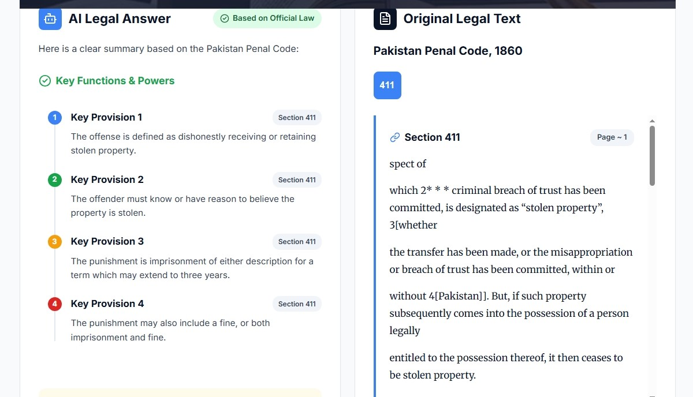
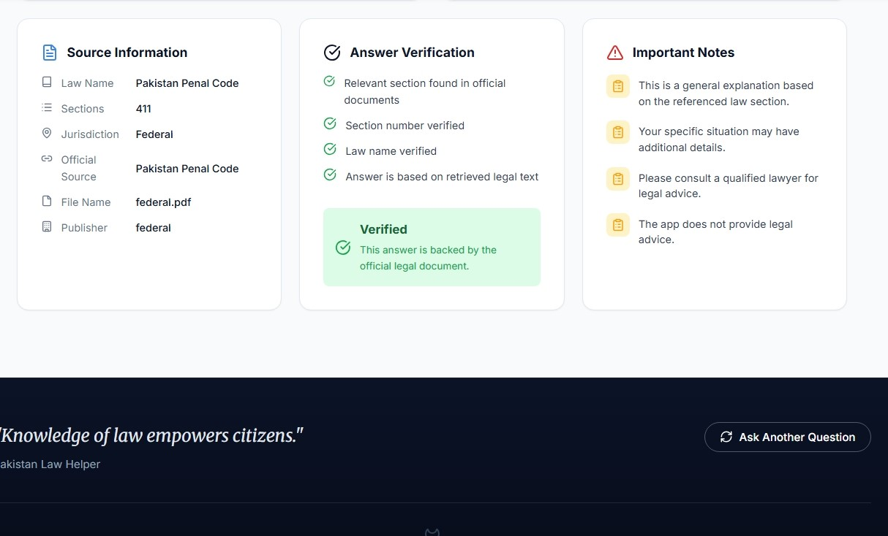

# Pakistan Law Helper - Statutory RAG Intelligence Platform

<p align="center">
  <a href="https://sohail.devsil.com"><strong>Portfolio</strong></a> | 
  <a href="https://github.com/sohailahmed-bsrh"><strong>GitHub Profile</strong></a> | 
  <a href="https://github.com/sohailahmed-bsrh/pakistan-law-helper"><strong>Source Repository</strong></a>
</p>

---

## Executive Summary & Problem Statement

Legal research in the Pakistani jurisprudence system is hindered by fragmented statutory archives, scattered provincial amendments, and dense statutory language across decades of legislative gazettes. Legal practitioners, law students, and citizens face significant overhead when cross-referencing procedural codes against relevant precedent and constitutional provisions.

Pakistan Law Helper solves this challenge through a specialized Retrieval-Augmented Generation (RAG) platform. By indexing federal statutes, provincial amendments, and procedural codes, the platform retrieves statutory sections with citation accuracy, providing structured legal analysis while eliminating hallucinations.

<div align="center">
  
  <p><em>Statutory intelligence architecture for federal and provincial legal research.</em></p>
</div>

---

## Real-World Industry Applications

- **Legal Practice Research**: Litigators query procedural requirements under the Code of Criminal Procedure (CrPC) and Civil Procedure Code (CPC) with immediate statutory section references.
- **Corporate Compliance**: Corporate legal teams cross-examine federal tax, labor, and commercial laws with provincial-level variances across Punjab, Sindh, KPK, and Balochistan.
- **Academic Legal Studies**: Law students and researchers examine constitutional provisions, statutory cross-references, and procedural frameworks in a single interface.
- **Citizen Legal Access**: Provides accessible, structured explanations of statutory rights and regulatory requirements in plain language with verified legal citations.

---

## Technical Architecture & Engineering Walkthrough

The platform operates across an end-to-end statutory ingestion, vectorization, and grounded generation lifecycle:

```
[Statutory Acts & Codes] 
        │
        ▼
[Document Parsing & Semantic Section Chunking]
        │
        ▼
[High-Dimensional Vector Embeddings (Sentence Transformers)]
        │
        ▼
[Vector Database Storage (FAISS / Chroma Vector Index)]
        │
   [User Query] ──► [Jurisdiction Filtering] ──► [Top-K Semantic Retrieval]
                                                          │
                                                          ▼
                                            [LLM Context Injection & Citation Grounding]
                                                          │
                                                          ▼
                                            [FastAPI REST Response with Section References]
```

### Step 1: Document Processing and Chunking
Legal texts possess strict hierarchical structures (Part, Chapter, Section, Sub-section, Proviso). Standard fixed-token window chunking breaks legal dependencies. The ingestion pipeline (`backend/ingest_laws.py`) employs statutory boundary chunking, preserving section headers, numbers, and provisos in the same chunk metadata.

### Step 2: Vector Embedding & Storage
Chunks are encoded into vector space using semantic legal embeddings, mapping legal terminology to relevant statutory provisions. High-dimensional vectors are stored with jurisdiction tags (`Federal`, `Punjab`, `Sindh`, `Khyber Pakhtunkhwa`, `Balochistan`, `Islamabad Capital Territory`, `Azad Jammu & Kashmir`, `Gilgit-Baltistan`).

### Step 3: Jurisdictional Filtering & Hybrid Retrieval
Incoming user queries pass through an entity and jurisdiction classifier. The retrieval engine filters vector space by target jurisdiction before executing semantic similarity search, preventing cross-jurisdiction statutory confusion.

### Step 4: Grounded Legal Generation
The top retrieved statutory chunks are formatted with explicit citation requirements (`backend/app/rag.py` and `backend/app/answer.py`). The generation engine constructs responses citing specific section numbers, act names, and applicable provisions without speculative legal advice.

### Step 5: Web Interface & Jurisdiction Selector
The React/Vite front-end provides an intuitive legal workspace, featuring provincial seal iconography, query history, citation display cards, and instant query execution.

---

## User Interface & Application Showcase

<table width="100%">
  <tr>
    <td width="50%" align="center">
      
      <p><strong>Primary Legal Assistant Dashboard</strong><br/>Jurisdiction selection and natural language query input.</p>
    </td>
    <td width="50%" align="center">
      
      <p><strong>Statutory Search and Citation Retrieval</strong><br/>Structured section identification with legal citations.</p>
    </td>
  </tr>
  <tr>
    <td width="50%" align="center">
      
      <p><strong>Provincial Law Jurisdiction Selector</strong><br/>Granular routing across provincial and federal statutory codes.</p>
    </td>
    <td width="50%" align="center">
      
      <p><strong>Detailed Legal Provision Breakdown</strong><br/>Contextual explanations of procedural requirements.</p>
    </td>
  </tr>
  <tr>
    <td colspan="2" align="center">
      
      <p><strong>Comprehensive Statutory Report View</strong><br/>Multi-section cross-referencing and statutory citations.</p>
    </td>
  </tr>
</table>

---

## Technology Stack & Implementation Specifications

| Component | Technology | Version | Architectural Function |
| :--- | :--- | :--- | :--- |
| **Backend Framework** | FastAPI | 0.104+ | Asynchronous RESTful API for query execution and ingestion |
| **RAG Orchestration** | LangChain / Python RAG | 0.1+ | Prompt engineering, context synthesis, and chunk retrieval |
| **Vector Storage** | FAISS / ChromaDB | Latest | In-memory and persistent high-dimensional similarity index |
| **Embeddings** | HuggingFace Sentence Transformers | Latest | Semantic vectorization of statutory clauses |
| **Frontend Runtime** | React.js with Vite | 18.x | High-performance reactive client interface |
| **Styling & UI** | Tailwind CSS | 3.x | Clean responsive typography and jurisdiction badges |
| **Runtime Environment** | Python 3.10+ / Node 18+ | Production | Containerized and reproducible service execution |

---

## Installation & Setup Guide

### 1. Backend Service
```bash
cd backend
python -m venv venv
# Windows: venv\Scriptsctivate | Unix: source venv/bin/activate
pip install -r requirements.txt
python ingest_laws.py
uvicorn app.main:app --reload --port 8000
```

### 2. Frontend Client
```bash
cd frontend
npm install
npm run dev
```

---

## Author & Contact Information

<table width="100%">
  <tr>
    <td width="150" align="center" valign="middle">
      
    </td>
    <td>
      <h3>Sohail Ahmed</h3>
      <p><strong>Senior Software Engineer & AI Systems Architect</strong></p>
      <p>Specializing in Full-Stack AI Application Development, Computer Vision, Deep Learning Pipelines, and Scalable Automation Architectures.</p>
      <p>
        <a href="https://sohail.devsil.com"><strong>Portfolio Website</strong></a> | 
        <a href="https://github.com/sohailahmed-bsrh"><strong>GitHub Profile</strong></a> | 
        <a href="https://www.linkedin.com/in/sohail-ahmed-devsil/"><strong>LinkedIn</strong></a> | 
        <a href="https://www.kaggle.com/sohail2411126"><strong>Kaggle</strong></a> | 
        <a href="https://x.com/ahmed241126"><strong>Twitter/X</strong></a> | 
        <a href="mailto:se906403@gmail.com"><strong>Email Contact</strong></a>
      </p>
    </td>
  </tr>
</table>
