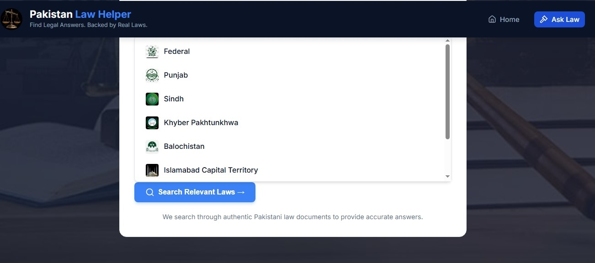
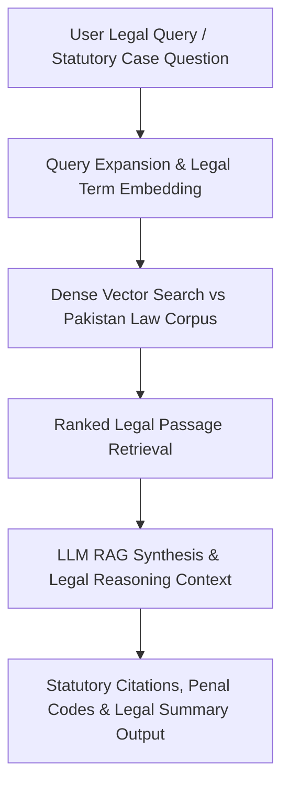

<div align="center">

<h1>Pakistan Law Legal Intelligence Assistant</h1>


<p><strong>Specialized Retrieval-Augmented Generation Legal Assistant Covering Pakistan Penal and Civil Statutes</strong></p>

<p>
  <a href="https://skillicons.dev"></a>
</p>

<p>
  <a href="#overview">Overview</a> &bull;
  <a href="#system-architecture">Architecture</a> &bull;
  <a href="#visual-showcase-gallery">Visual Gallery</a> &bull;
  <a href="#core-capabilities">Capabilities</a> &bull;
  <a href="#installation--setup">Installation</a> &bull;
  <a href="#author--contact-information">Author</a>
</p>

</div>

---
## Overview

Pakistan Law Helper is an artificial intelligence research tool designed to assist legal practitioners, researchers, and citizens with statutory queries regarding Pakistan penal, civil, and constitutional law. Utilizing Retrieval-Augmented Generation (RAG) and dense vector embeddings, the system retrieves relevant statutory sections, procedural rules, and legal precedents.

---

## Visual Showcase Gallery

<table width="100%" align="center">
  <tr>
    <td width="50%" align="center"><b>Legal Research Query Interface</b><br><sub>Natural language legal query search with jurisdiction filtering.</sub></td>
    <td width="50%" align="center"><b>Statutory Section Reference Viewer</b><br><sub>Contextual presentation of relevant code articles and citations.</sub></td>
  </tr>
  <tr>
    <td align="center"></td>
    <td align="center"></td>
  </tr>
  <tr>
    <td width="50%" align="center"><b>Jurisdiction & Province Filter</b><br><sub>Filtering across Federal, Punjab, Sindh, KPK, and Balochistan statutes.</sub></td>
    <td width="50%" align="center"><b>Legal Reasoning & Citation Matrix</b><br><sub>Step-by-step statutory interpretation with source code references.</sub></td>
  </tr>
  <tr>
    <td align="center"></td>
    <td align="center"></td>
  </tr>
  <tr>
    <td colspan="2" align="center"><b>Case Law Search & Historical Precedent Viewer</b><br><sub>Searchable repository of reported judicial rulings and statutory notes.</sub></td>
  </tr>
  <tr>
    <td colspan="2" align="center"></td>
  </tr>
</table>

---

## System Architecture



---

## Technology Stack

| Layer | Technologies |
| :--- | :--- |
| Frontend | React, JavaScript, CSS |
| Backend | Python, FastAPI, LangChain |
| Vector Embeddings | ChromaDB / Sentence-Transformers |

---

## Installation & Setup

```bash
# Clone the repository
git clone https://github.com/sohailahmed-bsrh/pakistan-law-helper.git
cd pakistan-law-helper

# Setup backend
cd backend
pip install -r requirements.txt
python main.py

# Setup frontend
cd ../frontend
npm install
npm start
```
---

## Author & Contact Information

<table width="100%" align="center">
  <tr>
    <td align="center" style="padding: 20px;">
      <h3>Sohail Ahmed</h3>
      <p><strong>Full-Stack Artificial Intelligence & Computer Vision Engineer</strong></p>
      <p>
        <a href="https://sohail.devsil.com"></a>
        <a href="https://github.com/sohailahmed-bsrh"></a>
        <a href="https://linkedin.com/in/sohail-ahmed-dev"></a>
        <a href="mailto:sohail.bsrh@gmail.com"></a>
      </p>
      <p><em>Available for technical roles in Artificial Intelligence, Computer Vision, and Full-Stack Engineering.</em></p>
      <hr style="border: 0; height: 1px; background: #30363d; margin: 15px 0;">
      <small>Repository: <code>sohailahmed-bsrh/pakistan-law-helper</code> &bull; Distributed under the MIT License.</small>
    </td>
  </tr>
</table>
