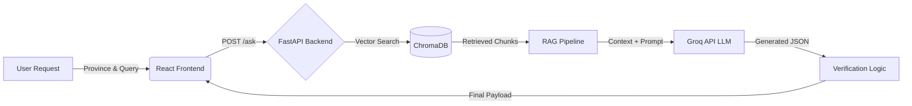

<div align="center">
  
  
  <br>
  
  
  
  <p align="center">
    <strong>A modern Retrieval-Augmented Generation (RAG) platform delivering accurate, verified, and transparent Pakistani legal information.</strong>
  </p>

  <p align="center">
    <a href="#-project-overview">Overview</a> •
    <a href="#-core-features">Features</a> •
    <a href="#-how-it-works">How it Works</a> •
    <a href="#-installation--setup">Setup</a> •
    <a href="#-api-documentation">API</a>
  </p>

  <p align="center">
    
    
    
    
    
  </p>
</div>

<br>

# 📖 **Project Overview**

**Pakistan Law Helper** is an educational AI assistant designed specifically for law students, researchers, and citizens seeking structured access to Pakistani legal texts. By leveraging a custom **Retrieval-Augmented Generation (RAG)** pipeline, the system parses millions of tokens of official provincial and federal legal PDFs to provide highly accurate answers. 

Unlike generic LLMs that may hallucinate laws, this application cross-verifies every generated answer against the embedded legal text, ensuring that users receive the exact law name, section number, and original context.

> [!WARNING]
> **Educational Use Only:** This application is built for research and educational purposes. It is **not** a replacement for professional legal advice. Always consult a qualified lawyer and refer to official government gazettes for legal actions.

---

# ✨ **Core Features**

- **🧠 RAG-Powered Legal Answering:** Retrieves context from embedded PDF laws instead of relying on generic pre-trained LLM weights.
- **📍 Jurisdiction-Aware Filtering:** Filters vector searches by province (Federal, Punjab, Sindh, KPK, Balochistan, AJK, GB).
- **✅ Automated Verification System:** Cross-checks the LLM's answer with the retrieved chunks. If evidence is insufficient, it strictly defaults to *"I don't know"*.
- **📄 Transparent Source Citation:** Displays the original retrieved legal text, document name, and metadata right alongside the AI answer.
- **⚡ Ultra-Fast Inference:** Powered by the **Groq API** for near-instantaneous token generation.
- **🎨 Premium UI/UX:** Responsive, card-based interface with micro-animations and verified/unverified visual states.

---

# 📸 **Workflow & Screenshots**

<div align="center">
  
### 1. Ask a Legal Question
*Select your jurisdiction and input a specific legal query.*
<br>


<br><br>

### 2. Loading State
*The system queries ChromaDB and generates the response via Groq.*
<br>


<br><br>

### 3. AI Answer & Original Text
*The LLM processes the retrieved text and provides the exact law references.*
<br>


<br><br>

### 4. Source Information & Verification
*Strict metadata mapping ensures you know exactly where the answer came from.*
<br>


<br><br>

### 5. Unknown/Empty State Safety
*If the law doesn't exist, the system safely declines rather than hallucinating.*
<br>


</div>

---

# ⚙️ **How it Works**



---

# 🚀 **Installation & Setup**

### Requirements
- Node.js (v16+)
- Python 3.9+
- Groq API Key

### 1. Backend Setup

Navigate to the backend directory and set up the Python environment:

```bash
cd backend
python -m venv venv

# Windows
.\venv\Scripts\activate
# Mac/Linux
source venv/bin/activate

pip install -r requirements.txt
```

Create a `.env` file in the `backend/` directory:
```env
GROQ_API_KEY=YOUR_GROQ_API_KEY
CHROMA_DB_PATH=./data/chroma_db
```

Run the FastAPI server:
```bash
uvicorn app.main:app --reload --host 127.0.0.1 --port 8000
```

*(Note: Ensure you have run `python ingest_laws.py` to process PDFs into ChromaDB if you are starting with a fresh database).*

### 2. Frontend Setup

Open a new terminal and navigate to the frontend directory:

```bash
cd frontend
npm install
npm run dev
```

The application will now be available at `http://localhost:5173`.

---

# 📡 **API Documentation**

### 1. Ask a Legal Question
**`POST /api/legal/ask`**

Retrieves legal context from the vector database and generates a verified answer.

**Request Body:**
```json
{
  "question": "What is the punishment for dishonestly receiving stolen property?",
  "province": "Federal"
}
```

**Success Response (200 OK):**
```json
{
  "question": "What is the punishment for dishonestly receiving stolen property?",
  "province": "Federal",
  "searchId": "PLH-0000-01",
  "answer": "Whoever dishonestly receives or retains any stolen property...",
  "keyPoints": [
    "Requires dishonest receipt or retention.",
    "Requires knowledge that it is stolen."
  ],
  "lawName": "Pakistan Penal Code",
  "year": "1860",
  "sectionNumber": "411",
  "originalLegalText": "...[Raw context from ChromaDB]...",
  "verificationStatus": "Verified",
  "sourceInformation": {
    "officialSource": "Pakistan Penal Code",
    "publisher": "federal",
    "reference": "federal.pdf"
  }
}
```

### 2. Health Check
**`GET /api/legal/health`** (or `/health`)

**Success Response (200 OK):**
```json
{
  "backend": "ok",
  "chromadb": "ok",
  "message": ""
}
```

---

# 👨‍💻 **About the Author**

<div align="center">
  
  
  ### Sohail Ahmed
  **AI Engineer | Data Scientist**
  
  Building intelligent AI systems that solve real-world problems through data, automation, and innovation. Specialized in Machine Learning, Generative AI (LLMs/RAG), and intelligent automation.
  
  <br>

  [](https://sohail.devsil.com)
  [](https://github.com/sohail-ahmed-26)
  [](https://www.linkedin.com/in/sohail-ahmed-devsil)
</div>

<br>

<div align="center">
  <i>Empowering legal research through accessible and transparent Artificial Intelligence.</i>
</div>

<div align="center">
  
</div>
