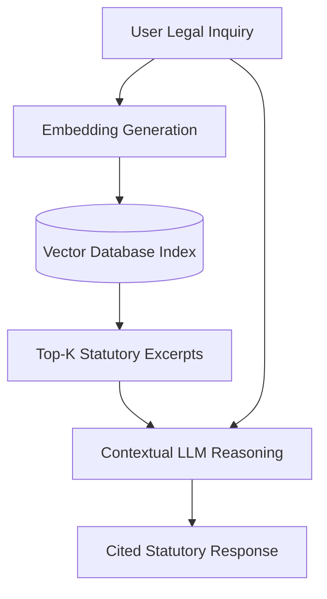

# Pakistan Legal Code Information Retrieval System

> RAG-powered legal question-answering architecture indexing foundational statutory codes of Pakistan.

[](https://github.com/sohailahmed-bsrh/pakistan-law-helper)
[](https://sohail.devsil.com/projects.html)
[](https://sohail.devsil.com)

---

## Overview

Navigating statutory codes and legal precedents in Pakistan is complex, time-consuming, and inaccessible to citizens without legal training.

This project provides an end-to-end, reproducible implementation engineered to solve this challenge through verified data transformations, reliable algorithms, and production-ready architecture.

---

## Key Features

- Vector retrieval indexing the Pakistan Penal Code, Constitution, and procedural statutes
- Semantic chunking and embedding generation for high-precision retrieval
- Contextual answer synthesis referencing exact statutory sections and citations
- FastAPI backend paired with modular legal ingestion scripts

---

## System Architecture



---

## Technology Stack

| Technology | Version / Spec | Role in Architecture |
| :--- | :--- | :--- |
| **LangChain** | `0.1+` | RAG chain orchestration and retrieval abstraction |
| **ChromaDB** | `0.4+` | Vector database for statutory chunk storage |
| **FastAPI** | `0.104+` | REST API service serving retrieval queries |
| **Python** | `3.10+` | Document ingestion, chunking, and metadata parsing |

---

## Repository Structure

```text
pakistan-law-helper/
|-- backend/
|   |-- app/
|   |   |-- answer.py
|   |   |-- api.py
|   |   |-- main.py
|   |   `-- rag.py
|   |-- data/law/
|   `-- ingest_laws.py
|-- src/
|-- .env.example
|-- .gitignore
|-- requirements.txt
`-- README.md
```

---

## Installation and Execution

### Prerequisites
- Python 3.10 or higher
- Git version control
- Virtual environment manager (`venv`)

### Setup Instructions
1. Clone the repository:
```bash
git clone https://github.com/sohailahmed-bsrh/pakistan-law-helper.git
cd pakistan-law-helper
```

2. Configure environment and dependencies:
```bash
python -m venv venv
source venv/bin/activate  # On Windows: venv\Scripts\activate
pip install -r requirements.txt
cp .env.example .env
python backend/app/main.py
```

---

## Interface and Verification
The system produces verifiable execution logs, prediction matrices, or interactive browser interfaces depending on the target mode. Verify operation by executing the commands specified above or inspecting the demonstration notebooks.

---

## Author and Contact
Developed by **Sohail Ahmed** — Full Stack AI Engineer & Machine Learning Specialist.
- **Portfolio:** [sohail.devsil.com](https://sohail.devsil.com)
- **GitHub:** [@sohailahmed-bsrh](https://github.com/sohailahmed-bsrh)
- **Email:** [sohail.bsrh@gmail.com](mailto:sohail.bsrh@gmail.com)
